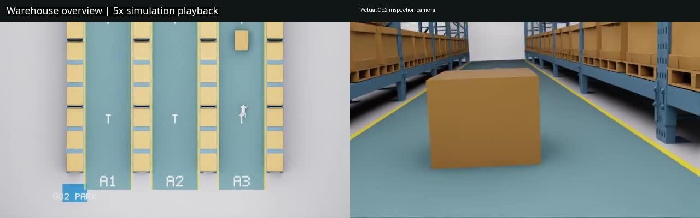
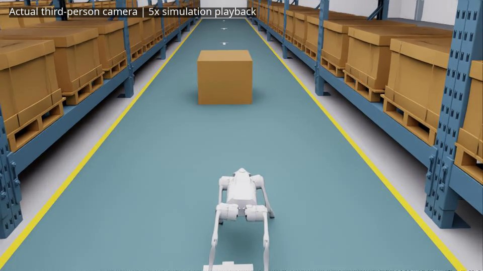
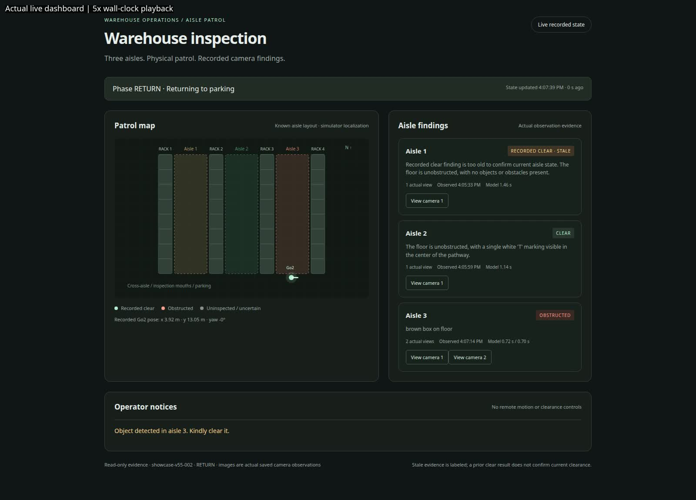
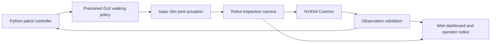

# Go2 Warehouse Patrol with NVIDIA Cosmos

**A robot dog that inspects warehouse aisles, investigates obstructions, and reports findings to an operator.**

This proof of concept combines pretrained quadruped locomotion with visual reasoning in an enclosed warehouse simulation. Go2 checks each aisle from its entrance. When it spots a fallen carton, it walks closer, captures a second image, and confirms the finding before requesting clearance through a web dashboard.

## Technology stack

| Technology | How it is used |
| --- | --- |
| **NVIDIA Isaac Sim** | Warehouse simulation, robot articulation, physical joint actuation, and RTX rendering |
| **NVIDIA Isaac Lab** | Published pretrained Go2 walking policy, reused without locomotion training |
| **Unitree Go2** | Simulated quadruped for aisle inspection and closer investigation |
| **NVIDIA Cosmos** | Visual reasoning over actual robot-camera images to assess aisle obstructions |
| **PyTorch & Hugging Face Transformers** | Policy inference and local Cosmos model execution |
| **OpenUSD & NVIDIA SimReady assets** | Warehouse composition, rack and carton assets, physics metadata, and selected asset validation |
| **Isaac Sim Replicator** | RGB camera capture for inspection, overview, and third-person footage |
| **Python** | Waypoint control, patrol state machine, observation validation, evidence capture, and local HTTP services |
| **HTML, CSS & JavaScript** | Read-only dashboard with a patrol map, aisle findings, camera evidence, and operator notices |
| **Playwright & FFmpeg** | Actual dashboard capture and CPU encoding of demonstration videos |

The demonstrated setup runs Cosmos and RTX rendering on a laptop GPU, with simulation physics on CPU. Runtime requirements and pinned dependency details are documented in [setup](docs/SETUP.md).

## Demo

### Warehouse patrol

[](media/warehouse-patrol-v55.mp4)

An overview and the robot's inspection camera show the complete workflow: aisle checks, distant detection, closer confirmation, and return to parking. **[Watch the patrol](media/warehouse-patrol-v55.mp4).**

### Third-person view

[](media/third-person-v55.mp4)

An actual simulator camera follows Go2's measured position and heading as it patrols and investigates. **[Watch the follow camera](media/third-person-v55.mp4).**

### Dashboard walkthrough

[](media/dashboard-v55.mp4)

The live webpage shows inspection progress, aisle status, the confirmed clearance notice, and both actual carton observations. **[Watch the dashboard](media/dashboard-v55.mp4).**

Videos use actual captured frames at **5× playback**: simulation time for robot footage and wall-clock time for the dashboard. No motion interpolation or mocked findings are used. [Media provenance](media/PROVENANCE.json).

## Architecture



The waypoint controller selects where Go2 moves and looks. The walking policy converts robot observations and velocity commands into joint targets. Cosmos assesses camera images; validated findings drive the patrol's next state.

A blocked finding triggers a physical approach within the simulation and a second observation. Two fresh, separated, consistent findings confirm the obstruction. Failed, stale, or contradictory observations hold inspection instead of assuming clearance. The dashboard reports findings to a human operator; it does not command robot motion or declare an obstacle removed.

## Warehouse environment

**[Open the included warehouse USD](scene/WarehousePatrol_V55.usd).** The single-file scene contains an enclosed NVIDIA warehouse shell, one floor, four long carton-rack rows, three marked aisles, a Go2 parking bay, and a staged obstruction deeper inside an aisle.

Scene geometry and materials are embedded, so viewing the USD requires no external USD or texture files. Running the patrol additionally requires the simulator, model weights, policy assets, and documented source caches. [Scene details](docs/CLEAN_SCENE.md).

## Run locally

Follow [setup](docs/SETUP.md) to configure the simulator and Python environments, obtain model access, and prepare the external assets. Then use three terminals from the repository root:

```bash
# Start visual reasoning; wait for COSMOS_INCIDENT_READY
./app cosmos --task patrol --device cuda --attempt cosmos-demo

# Run the patrol and capture the follow camera
./app patrol --attempt warehouse-demo --seconds 240 --third-person --capture-hz 5

# Start the dashboard after the patrol evidence folder exists
./app dashboard --attempt warehouse-demo --port 8126
```

Open **http://127.0.0.1:8126/**. Add `--no-headless` to the patrol command for a live Isaac Sim window. Headless recording reduces GPU memory demand. Use fresh attempt names for each run; existing evidence is preserved. [Rendering guidance](docs/RENDER_TROUBLESHOOTING.md).

## Validation and scope

The recorded demonstration completed all aisle inspections: two aisles clear, one obstruction confirmed from two camera views, an operator notice issued, and Go2 returned to parking. Independent evidence verification and the CPU test suite passed. [Recorded results](docs/LATEST_SHOWCASE_RUN.json).

This is a simulation PoC with known robot poses, an ideal virtual camera, and one staged obstruction. General perception accuracy and real-robot deployment remain unverified. Selected SimReady checks passed; full SimReady certification is not claimed.

## Attribution

Built using NVIDIA Isaac Sim, Isaac Lab, Cosmos, NVIDIA warehouse and SimReady assets, and the Unitree Go2 simulation model. Upstream assets and models retain their own terms. See [third-party attribution](THIRD_PARTY.md) and the notices under [scene](scene/).

<details>
<summary>Earlier demonstrations</summary>

- [Earlier paired-camera patrol](media/warehouse-patrol.mp4)
- [Earlier third-person patrol](media/third-person-follow.mp4)
- [Original AMR investigation concept](media/amr-investigation-legacy.mp4)

These preserved recordings show earlier layouts and workflows.
</details>
